<div align="center">


# nosZviz

**NosZRef 结果的一站式发表级可视化 —— 113 种图型，一行代码出全套**

[](https://cran.r-project.org/)
[](https://github.com/ZhangBaoshan668/nosZviz)
[](#-图库预览)
[](#-图型清单)
[](LICENSE)
[](#-安装)

[快速开始](#-30-秒上手) ·
[图库预览](#-图库预览) ·
[图型清单](#-图型清单) ·
[常见问题](#-常见问题) ·
[安装教程](inst/INSTALL_zh.md)

</div>

---

`nosZviz` 是 [NosZRef](https://github.com/ZhangBaoshan668/NosZRef)（*nosZ* 基因宏基因组分析流程）的**官方可视化扩展层**。
它直接读取 NosZRef 的输出目录，不需要你重新整理任何中间文件，即可生成**投稿级**图表：
丰度分配、分类组成、alpha/beta 多样性、差异丰度、共现网络，以及 NosZRef 内置可视化**没有覆盖**的
**支系生态学叙事层**（Clade I/II/III 分辨率始终保持）与**环境因子关联层**（RDA/CCA/Mantel）。

## 为什么还需要一个可视化包？

NosZRef 内置出图解决的是"有没有图"，`nosZviz` 解决的是"这张图能不能直接进正文"。

| 维度 | NosZRef 内置可视化 | nosZviz |
|---|---|---|
| 支系分辨率 | 三分支常被合并展示 | **每个支系单独出图**，Clade II/I 比值、支系×分类嵌套组成 |
| 统计注释 | 少量 | PERMANOVA / ANOSIM / MRPP、Wilcoxon + BH、IndVal 置换检验、Mantel，**P 值直接标注在图上** |
| 环境因子 | 无 | RDA / CCA / db-RDA、envfit、Mantel 组合图、alpha×环境热图、类群-环境网络 |
| 差异分析 | 基础 | 火山 / MA / 森林 / STAMP / LEfSe / 指示种 / UpSet / bump |
| 导出 | 屏幕截图 | 每张图 **PDF（矢量）+ PNG（300–600 dpi）**，尺寸按 mm 精确控制 |
| 可复现 | 手动点选 | `noszref_visualize()` 一条命令出全套 + 带「复制代码」按钮的 HTML 图库 |

## 📦 安装

```r
# 推荐：从 GitHub 安装
install.packages("remotes")
remotes::install_github("ZhangBaoshan668/nosZviz")
```

只依赖 CRAN 包，**不需要 Rtools**（纯 R 实现，无 C/C++ 源码）。

<details>
<summary>其他安装方式 / 依赖清单</summary>

```r
# 1) 从本地源码包（tar.gz）
install.packages("nosZviz_0.2.0.tar.gz", repos = NULL, type = "source")

# 2) 从源码目录（改了代码之后重装）
remotes::install_local("path/to/nosZviz", upgrade = "never")

# 3) 想连 vignette 图库一起构建（需 rmarkdown + knitr + pandoc）
remotes::install_github("ZhangBaoshan668/nosZviz", build_vignettes = TRUE)
```

依赖包（缺失时 `install_github` 会自动尝试安装，也可手动一次装齐）：

```r
install.packages(c(
  "ggplot2", "dplyr", "magrittr", "rlang", "tidyr", "tibble", "readr",
  "purrr", "stringr", "forcats", "scales",
  "vegan", "igraph", "ggraph", "patchwork",
  "RColorBrewer", "ggrepel", "pheatmap", "ggpubr", "ggalluvial",
  "UpSetR", "ggridges", "circlize", "viridisLite", "gridExtra"
))
```

</details>

> 国内网络拉取 GitHub 较慢时，可先下载仓库 zip 解压，再用 `remotes::install_local()` 安装。
> 装不上？见 **[安装教程](inst/INSTALL_zh.md)**（含 10 条报错排查）。

## 🚀 30 秒上手

```r
library(nosZviz)

# 1) 指向 NosZRef 输出目录（含 merge/ 的那一层，也可直接传路径）
res <- read_noszref("path/to/NosZRef/output")
res                     # 打印识别到的分支与可用结果

# 2) 一键出全套：PDF + PNG + 统计表 + HTML 图库
noszref_visualize(res, outdir = "nosZviz_output",
                  formats = c("pdf", "png"), dpi = 600)
# 打开 nosZviz_output/index.html —— 每张图都带「复制代码」按钮
```

有环境因子表时（CSV，含 `SampleID` 列 + 数值列），多出整套环境关联图：

```r
noszref_visualize(res, outdir = "nosZviz_output_env", env = "env.csv")
```

单张图同样简单——所有绘图函数第一个参数都是 `res`：

```r
plot_branch_rpkm(res)                                # 三分支丰度
plot_clade_profile(res, rank = "phylum")             # 支系嵌套分类组成
plot_ordination(res, method = "PCoA")                # PCoA + PERMANOVA 注释
plot_mantel_env(res, env)                            # 环境热图 + Mantel 连线
nosz_save(p, "fig1", width = 180, height = 120,
          formats = c("pdf", "png"), dpi = 600)      # 按 mm 尺寸导出
```

## 🖼 图库预览

> ### 👉 [**浏览完整 113 张图型（在线图库）**](https://zhangbaoshan668.github.io/nosZviz/)
> 按 9 个分析类型分区 · 关键词搜索 · 每张图带「复制代码」按钮。仓库内即 `docs/` 目录。

**这里只放 12 张代表图（每个分析类型至少 1 张）。** 把 113 张 PNG（约 10 MB）全塞进 README 会让首屏几乎加载不动、
页面要滚几十屏，因此完整图库单独放在 `docs/`（GitHub Pages）。自己跑一遍 `noszref_visualize()`，
输出目录里同样会生成一份可离线浏览的 `index.html`。

<div align="center">

| 支系嵌套分类组成 · **Clade** | 环境热图 + Mantel 连线 · **Environment** |
|:---:|:---:|
| 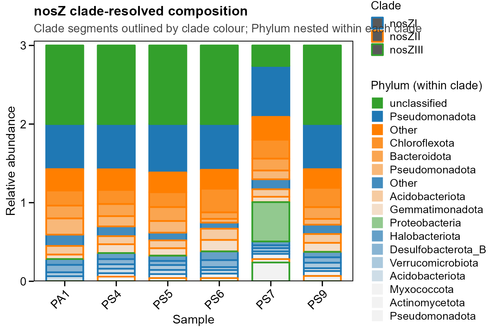 | 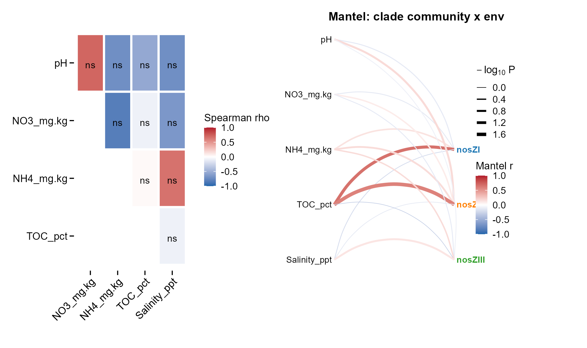 |
| **Clade II 的优势由哪个类群驱动？** | **群落差异由哪个环境因子解释？** |

| 分组 ↔ 支系弦图 · **Clade** | 四面板总览 · **Overview** |
|:---:|:---:|
| 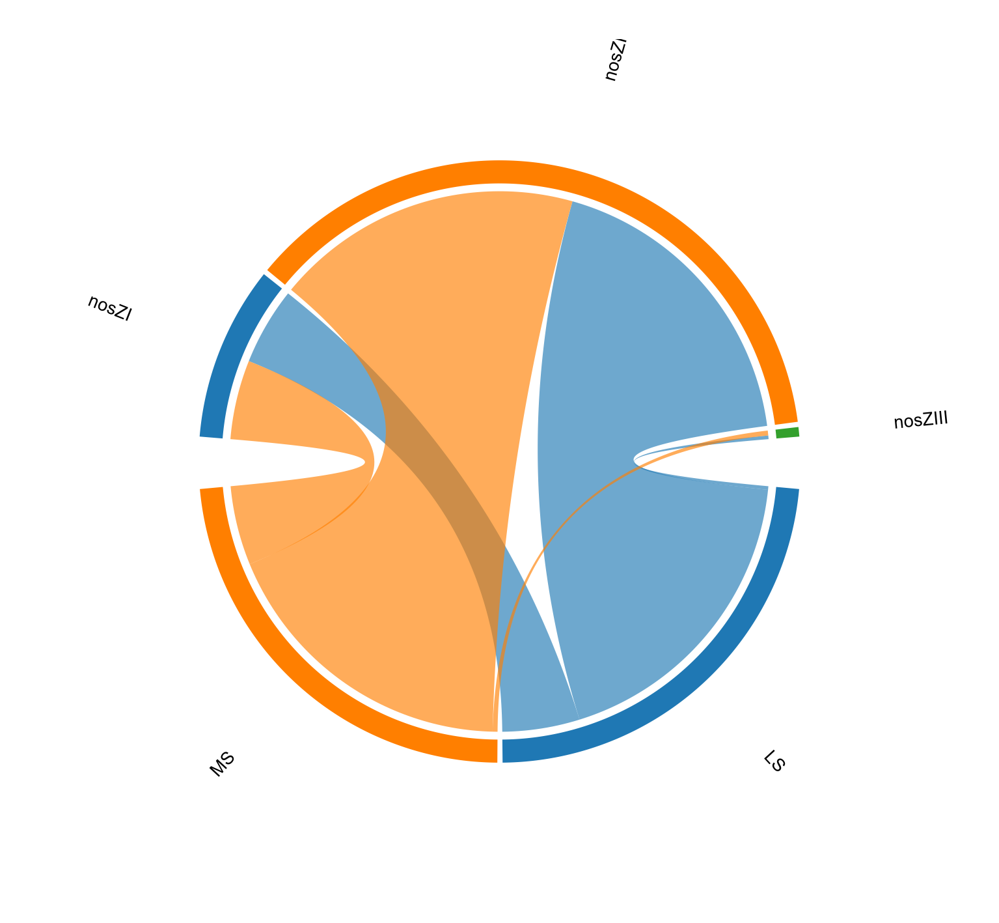 | 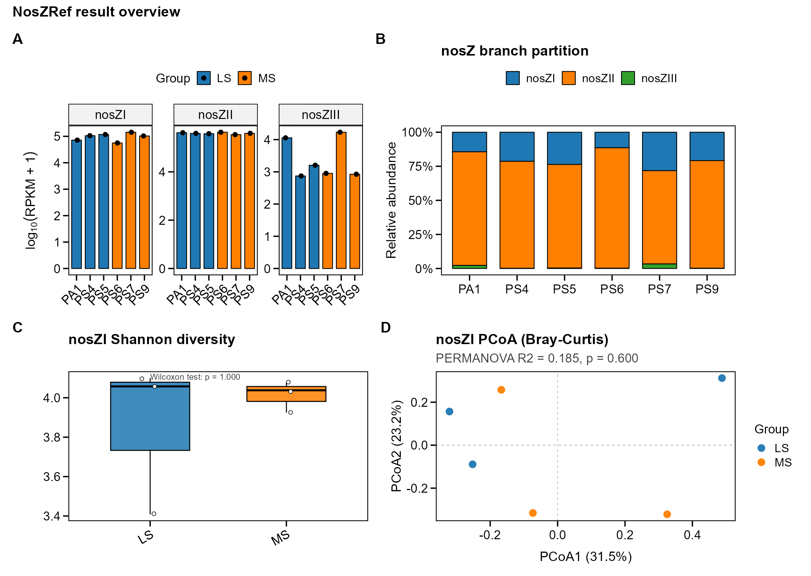 |

| 共现网络（模块 + hub）· **Network** | 约束排序 RDA · **Environment** |
|:---:|:---:|
| 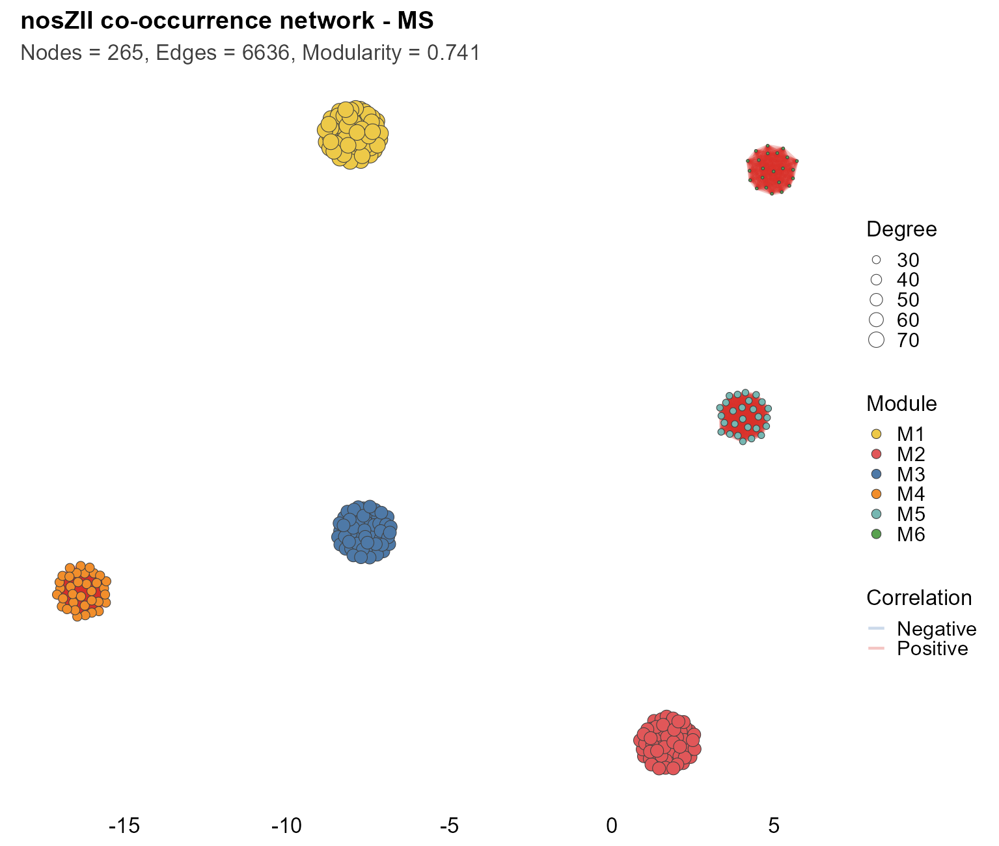 | 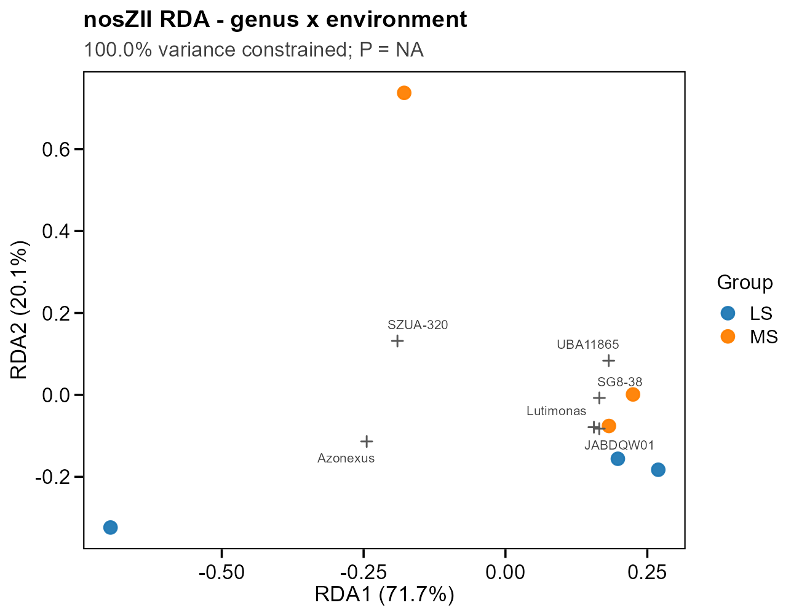 |

| 三分支丰度 · **Abundance** | 分类组成日辉图 · **Composition** |
|:---:|:---:|
| 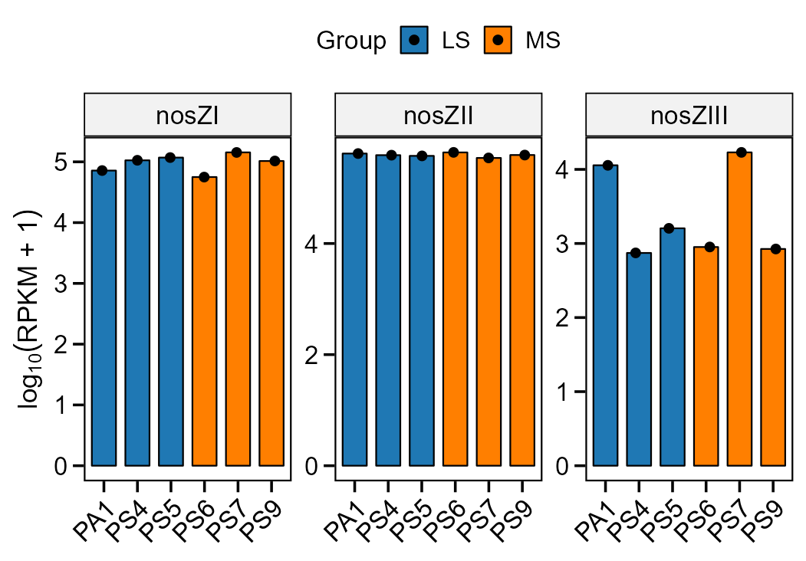 | 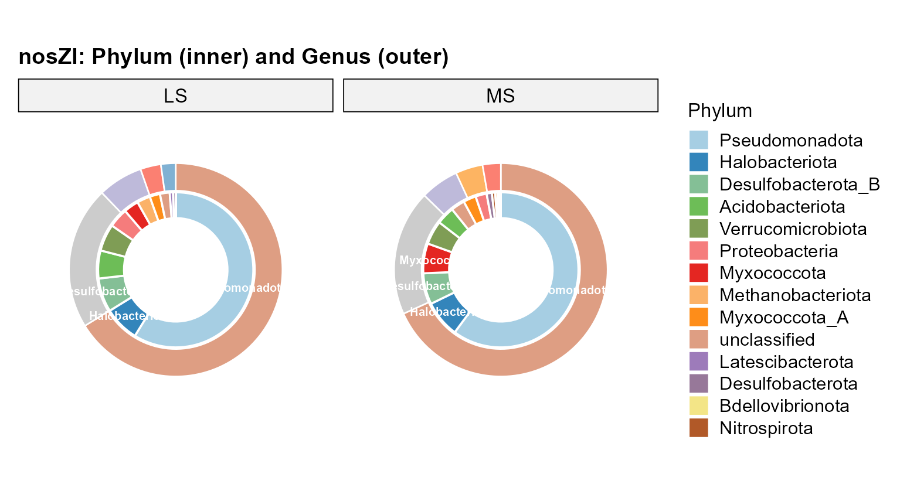 |

| LEfSe 差异类群 · **Differential** | alpha 山脊图 · **Alpha** |
|:---:|:---:|
| 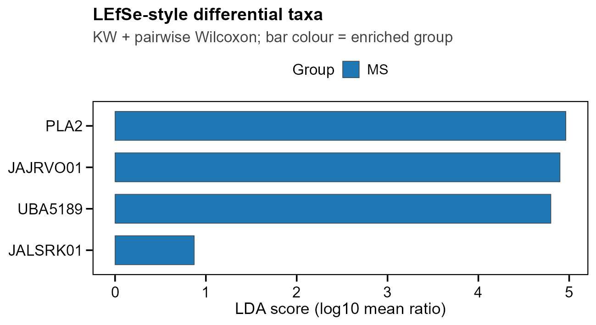 | 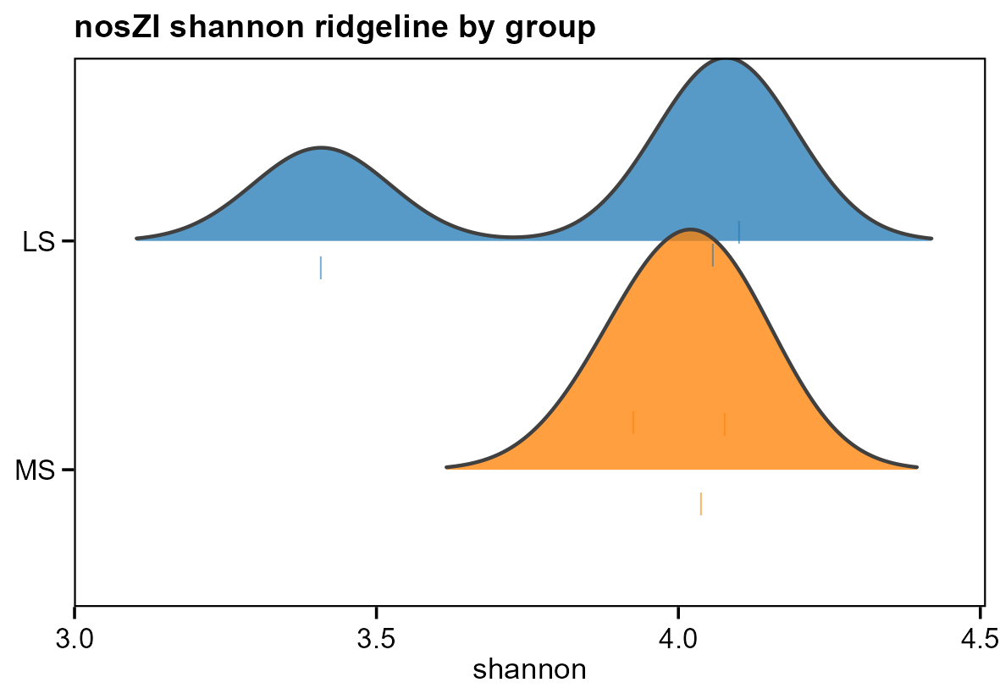 |

| PCoA 排序 · **Beta** | 环境因子相关矩阵 · **Environment** |
|:---:|:---:|
| 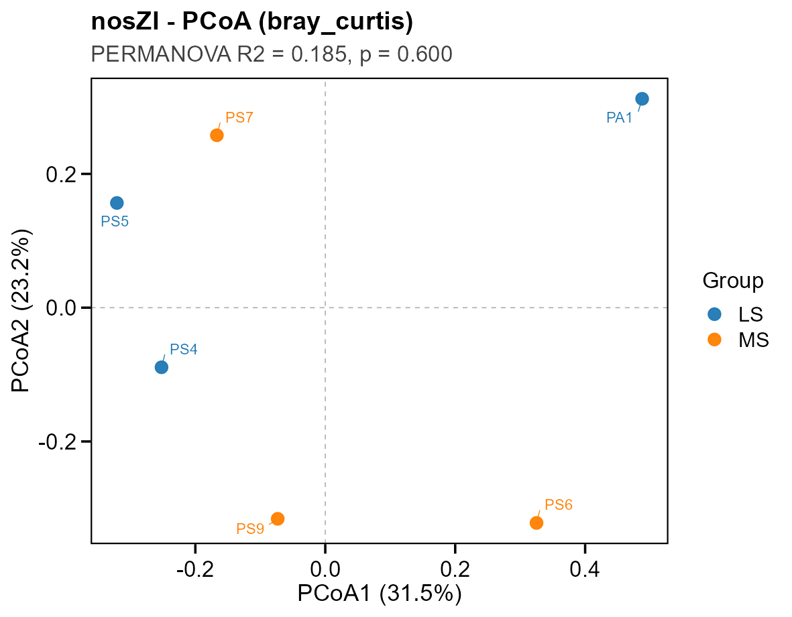 | 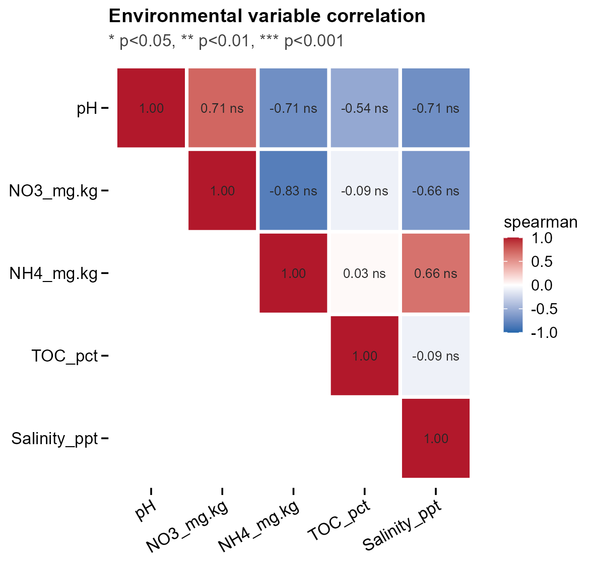 |

</div>

`noszref_visualize()` 在自带示例数据（6 样本、2 分组、3 分支）上生成 **113 张图 / 226 个文件**，
按分析类型分组：

| 分类 | 图数 | 分类 | 图数 |
|---|---:|---|---:|
| Abundance 丰度与分支分配 | 9 | Alpha 多样性 | 12 |
| Composition 分类组成 | 24 | Beta 多样性 | 16 |
| Differential 差异丰度 | 18 | Network 共现网络 | 14 |
| **Clade 支系生态学** ✨ | 9 | **Environment 环境关联** ✨ | 10 |
| Overview 综合总览 | 1 | **合计** | **113** |

✨ = NosZRef 内置可视化未覆盖的新图型。

## 📋 图型清单

<details open>
<summary><b>支系生态学</b>（v0.2.0 新增，Clade I/II/III 分辨率永不丢失）</summary>

| 函数 | 图型 / 回答的问题 |
|---|---|
| `plot_clade_profile()` | 支系嵌套分类组成：支系段描边 + 支系内分类渐变填充 |
| `plot_clade_ratio()` | Clade II / Clade I log2 比值柱（*nosZ* 文献经典指标） |
| `plot_clade_scatter()` | 支系两两 RPKM 散点 + Spearman 相关 |
| `calc_clade_stats()` | 每样本支系丰度/占比表（可直接进补充材料） |
| `plot_chord()` | 分组 ↔ 支系丰度流向弦图 |
| `plot_circular_bar()` | 分组 × 支系环形柱状图 |
| `plot_circular_heatmap()` | 样本 × 类群 z-score 环形热图（按支系分扇区） |
| `plot_tax_dendrogram()` | 类群丰度谱系 UPGMA 环形树（非系统发育树，图注已注明） |

</details>

<details>
<summary><b>环境因子关联</b>（v0.2.0 新增，需 <code>env=</code>）</summary>

| 函数 | 图型 |
|---|---|
| `plot_ordination_constrained()` | 约束排序 RDA / CCA / db-RDA（约束轴解释率 + 置换检验 P） |
| `plot_envfit_ordination()` | PCoA + envfit 环境向量（R² / P 标注） |
| `plot_mantel_env()` | 环境 Spearman 热图 + 支系群落 Mantel 连线组合图 |
| `plot_alpha_env_corr()` | alpha 指数 × 环境因子相关热图（显著性星号） |
| `plot_taxa_env_network()` | 类群-环境因子相关网络（正负边分色） |
| `plot_env_corrplot()` | 环境因子间相关热图（上三角 + 数值 + 星号） |

</details>

<details>
<summary><b>丰度与分支分配</b></summary>

| 函数 | 图型 |
|---|---|
| `plot_branch_rpkm()` | 三分支 RPKM 柱状 / 箱线 / 组均值 ± SD |
| `plot_branch_composition()` | 100% 堆叠柱 / 组均值环形图 |
| `plot_reads_partition()` | 原始 reads → 三分支桑基（冲积）图 |
| `plot_rank_abundance()` | Whittaker 秩-丰度曲线（log-log） |
| `plot_branch_heatmap()` | 样本 × 分支 z-score 热图 |
| `plot_branch_violin()` | 分支丰度小提琴 + 箱线 |
| `plot_overview_dashboard()` | 四面板综合总览 |

</details>

<details>
<summary><b>分类组成</b></summary>

| 函数 | 图型 |
|---|---|
| `plot_tax_stack()` | 堆叠柱（样本 / 分组两种布局，多分支自动分面） |
| `plot_tax_heatmap()` | Top-N 分类热图（行聚类 + 分组注释） |
| `plot_tax_bubble()` | 气泡图（大小 = 丰度，颜色 = z-score） |
| `plot_tax_area()` | 河流图 / 冲积图 |
| `plot_tax_sunburst()` | 门-属双层环形（sunburst） |
| `plot_tax_ternary()` | 三分支贡献三角图 |
| `plot_top_taxa()` | Top-N 分类分组条形（小倍数面板） |
| `plot_tax_corr()` | 属间 Spearman 相关热图（聚类排序） |
| `plot_taxa_bump()` | Top 类群丰度排名随分组变化的 bump 图 |

</details>

<details>
<summary><b>Alpha 多样性</b></summary>

| 函数 | 图型 |
|---|---|
| `plot_alpha_box()` / `plot_alpha_violin()` | 箱线 / 小提琴（自动 Wilcoxon / Kruskal 注释） |
| `plot_alpha_radar()` | 多指数雷达图 |
| `plot_rarefaction()` | 稀释曲线（组均值 ± SD） |
| `plot_alpha_heatmap()` | 样本 × 指数热图 |
| `plot_alpha_scatter()` | 指数两两散点 + Spearman 系数 |
| `plot_alpha_panel()` | 六指数组合面板（patchwork） |
| `plot_alpha_ridge()` | 组间密度山脊图 |

</details>

<details>
<summary><b>Beta 多样性</b></summary>

| 函数 | 图型 / 统计 |
|---|---|
| `calc_permanova()` | PERMANOVA / ANOSIM / MRPP / betadisper 一表输出 |
| `plot_ordination()` | PCoA / NMDS / PCA，置信椭圆 + PERMANOVA 注释 |
| `plot_beta_panel()` | 四种距离矩阵 PCoA 对比面板 |
| `plot_beta_heatmap()` | 距离矩阵热图 |
| `plot_beta_dendrogram()` | UPGMA 聚类树 + 分组着色 |
| `plot_beta_dispersion()` | 组内离散度箱线 |
| `plot_sample_corr()` | 样本间相关热图 |

</details>

<details>
<summary><b>差异丰度</b></summary>

| 函数 | 图型 |
|---|---|
| `calc_diff_taxa()` | 组间差异表（Wilcoxon / t / DESeq2 + BH 校正 + 95% CI） |
| `plot_diff_volcano()` | 火山图 |
| `plot_diff_ma()` | MA 图 |
| `plot_diff_forest()` | 效应量森林图（含 CI） |
| `plot_diff_stamp()` | STAMP 扩展误差条图（三联面板） |
| `plot_diff_heatmap()` | 差异分类热图（星号标注） |
| `calc_lefse()` + `plot_lefse()` | LEfSe 风格效应量条形图 |
| `calc_indicator()` + `plot_indicator()` | 指示种 IndVal（特异性 × 忠实度 + 置换检验） |
| `plot_group_upset()` | 组间共享 / 特有 OTU UpSet |

</details>

<details>
<summary><b>共现网络</b></summary>

| 函数 | 图型 |
|---|---|
| `plot_network()` | 网络图（模块着色、度定大小、正负边分色、hub 标注） |
| `plot_network_zipi()` | Zi-Pi 拓扑角色图 |
| `plot_network_properties()` | 拓扑参数组间对比 |
| `plot_network_degree()` | 度分布（log-log + 幂律拟合） |
| `plot_network_modules()` | 模块规模与连通性 |
| `plot_network_upset()` | 组间共享 / 特有节点 UpSet |

</details>

<details>
<summary><b>数据读取 · 主题 · 导出</b></summary>

| 函数 | 说明 |
|---|---|
| `read_noszref()` | 解析整个输出目录：分支 RPKM/reads、OTU 表、抽平表、7 级分类、alpha、6 种 beta 距离、BLAST 长表、网络拓扑 |
| `noszref_summary()` | 各分支数据可用性概览 |
| `nosz_tax_matrix()` / `nosz_otu_matrix()` | 提取分类矩阵 / OTU 表 |
| `prepare_env()` | 环境因子表准备与样本对齐 |
| `theme_nosz()` · `nosz_pal()` · `scale_fill_nosz()` · `scale_colour_nosz()` | 统一主题与配色 |
| `nosz_save()` | mm 尺寸、PDF + PNG 多格式一次导出 |
| `noszref_visualize()` | 一键全套（图表 + 统计表 + HTML 图库） |

</details>

## 🌡 环境因子表

出环境关联图需要一张环境表，要求很简单：

- 必须有一列 **`SampleID`**，取值与 NosZRef `metadata.txt` **完全一致**（大小写、空格都要一致）
- 其余列为**数值型**环境因子（pH、NO₃⁻、NH₄⁺、TOC、盐度……）
- CSV 或 `data.frame` 均可

```csv
SampleID,pH,NO3_mg.kg,NH4_mg.kg,TOC_pct,Salinity_ppt
PA1,7.81,12.3,4.1,1.18,3.2
PS4,6.95,5.2,9.3,1.25,11.8
```

## 🗂 识别的文件（NosZRef 输出）

```
outdir/
├── metadata.txt                    # SampleID<TAB>Group（自动读取，也可 design= 传入）
├── merge/
│   ├── sample_merged_total_reads.txt
│   └── nosZI/  nosZII/  nosZIII/
│       ├── {branch}_merged_rpkm.txt          # 分支总 RPKM
│       ├── {branch}_merged_results.txt       # 分支命中 reads
│       ├── {branch}_otutab.txt               # OTU 表
│       ├── alpha/{branch}_alpha_div.txt      # 6 种 alpha 指数
│       ├── alpha/{branch}_alpha_rare.txt     # 稀释曲线数据
│       ├── beta/{method}.txt                 # 6 种距离矩阵
│       ├── {branch}_merged_{rank}_rpkm.csv   # 7 级分类 RPKM
│       ├── {branch}_{rank}_merged_count.csv  # 7 级分类 reads
│       ├── {branch}_merged_tax.txt           # BLAST 注释长表
│       └── network/                          # 节点 / 边 / 拓扑统计
```

任何一步缺失都会被自动跳过，只有你请求对应图时才会给出明确报错。

## ❓ 常见问题

<details>
<summary><b>分组文件 metadata.txt 从哪来？</b></summary>

**不是 NosZRef 生成的，要你自己写。** NosZRef 的 `list.txt` 只有「样本名 → 目录名」，
不含任何表型信息；分组靠 `metadata.txt`，由你在跑流程前准备好，再用 `-m metadata.txt` 传给 `raw_main.py`：

```
SampleID	Group
PA1	LS
PS4	LS
PS5	LS
PS6	MS
PS7	MS
PS9	MS
```

- 必须有**表头行**，列名严格为 `SampleID` 与 `Group`（不能改名）
- `tab` 分隔，不要用逗号或空格；文件无 BOM
- `SampleID` 的第一列内容 = `list.txt` 第一列（**重命名后的样本号**，不是原始 fastq 文件名）
- 分组名建议无空格、无中文，如 `LS` / `MS` / `High` / `Low`

`read_noszref()` 的读取优先级：

| 顺序 | 来源 | 说明 |
|---|---|---|
| 1 | `design=` 参数 | 直接给 `data.frame` 或文件路径，**优先级最高**，可覆盖 `metadata.txt` |
| 2 | `<项目根>/metadata.txt` | 自动查找（NosZRef 流程会把 `-m` 的文件复制到这里） |
| 3 | `<项目根>/group.txt`、`design.txt` | 兼容其他命名 |
| 4 | 都没有 | 全部样本归为单一组 `"All"`，**并给出 warning** 列出查找过的路径 |

> `<项目根>` = `merge/` 的**上一级**。所以把路径直接指到 `.../case_study/merge`，只要 `metadata.txt`
> 在 `.../case_study/` 下就能读到——两者同级即可，不必把 `metadata.txt` 复制进 `merge/`。

列名容错：ID 列可写 `SampleID`/`Sample`/`sample_id`/`id`，分组列可写 `Group`/`groups`/`treatment`/`type`；
都识别不出时取第 1 列为 ID、第 2 列为组。**多余列会被保留**，所以环境因子可以并到同一张表里一起读。

分组到底读没读对，看 `print(res)` 新增的 `design` 一行即可（显示 `<none, all samples in "All">` 就是没读到）：

```r
res
#> NosZRef result object
#>   path     : .../case_study/merge
#>   branches : nosZI, nosZII, nosZIII
#>   samples  : 96 (LS/MS)
#>   design   : .../case_study/metadata.txt
```

若 `metadata.txt` 里的样本名与结果文件对不上（大小写、空格、后缀差异），`read_noszref()` 会警告并列出
对不上的 ID，而不是静默丢样本。

只想先跑起来、还没想好分组时，可以从 `list.txt` 一键生成模板：

```r
l <- read.table("list.txt", header = FALSE, sep = "\t")
d <- data.frame(SampleID = l[[1]], Group = "Group1")
write.table(d, "metadata.txt", sep = "\t", quote = FALSE, row.names = FALSE)
```
</details>

<details>
<summary><b>某分支的图整批被跳过？</b></summary>

该分支 OTU 太少（示例数据中 `nosZIII` 仅 1 个），alpha/beta/网络/树类图无法计算，包内会优雅跳过并记录。
这是预期行为，不是安装问题；真实数据不会出现。
</details>

<details>
<summary><b>置换检验结果不显著？</b></summary>

样本量小时（如 3 vs 3）置换检验可达的最小 P 值本身就有下界，包内会自动「完全枚举」并在图上注明。
LEfSe / 指示种在小样本下也可能无显著结果，此时会降级展示 top 类群并标注说明。
</details>

<details>
<summary><b>中文变方框 / HTML 图库乱码？</b></summary>

图内文字统一为英文（PDF 字体限制）；HTML 图库的中文乱码在 0.2.0 已修复，
请确认 `packageVersion("nosZviz")` 为 `0.2.0`。自定义中文标题建议导出 PNG，或配 `showtext` 注册中文字体。
</details>

<details>
<summary><b>更多安装问题</b></summary>

见 **[inst/INSTALL_zh.md](inst/INSTALL_zh.md)**：依赖装不上、`repos = NULL`、权限不足、
装到非默认库后 `library()` 找不到、离线安装等 10 条排查路径。
</details>

## 🌐 文档与图库站点

仓库里的 `docs/` 就是线上图库的源目录（`docs/index.html` + `docs/figures/*.png`，113 张，约 9.7 MB）：

```
docs/
├── index.html      # 图库首页：分类分区 + 搜索框 + 每图「复制代码」
├── .nojekyll       # 关掉 Jekyll，避免以下划线开头的资源被忽略
└── figures/        # 113 张 PNG（按图库编号或 {branch}_{plot} 命名）
```

首次发布到 GitHub Pages：

1. 把本目录推到 `ZhangBaoshan668/nosZviz` 的 `main` 分支；
2. 仓库 **Settings → Pages → Build and deployment**：Source 选 *Deploy from a branch*，
   Branch 选 `main`，目录选 **`/docs`**，Save；
3. 等 1–2 分钟，站点地址为 <https://zhangbaoshan668.github.io/nosZviz/>。

本地预览不用起服务器，直接双击 `docs/index.html` 即可。若要连 API 文档一起发布，
可用 `pkgdown::build_site()` 覆盖 `docs/`（届时把上面的 `figures/` 与图库首页并入 `pkgdown` 的 `articles/` 即可）。

> 想让图库跟着自己的数据更新：跑完 `noszref_visualize()` 后，把输出目录里的
> `index.html` 与 `figures/*.png` 覆盖到 `docs/`，提交即可（图表由当前数据重新生成）。

## 📖 引用

使用本包产出图表时，请引用 NosZRef 原文：

> Zhang B, Wang X, Kuang C, Wu J, Hong Y. Development of an integrated workflow (NosZRef) for rapid and
> accurate *nosZ* gene profiling and its application to oceanic ecosystems.
> *Marine Environmental Research*, 2026, 20: 108247.

图表涉及的统计算法请同时引用其原始实现：`vegan`（Oksanen et al.）、`igraph`（Csárdi & Nepusz）、
`circlize`（Gu et al.）等。

## 📄 License

MIT © Baoshan Zhang

## 🙏 致谢

- [NosZRef](https://github.com/ZhangBaoshan668/NosZRef) —— 数据来源与分析流程
- `ggplot2` / `vegan` / `igraph` / `circlize` / `patchwork` 等开源生态

---

<div align="center">

**如果这个包帮你省了作图时间，点个 ⭐ 支持一下**

问题与建议请提 [Issue](https://github.com/ZhangBaoshan668/nosZviz/issues)

</div>
